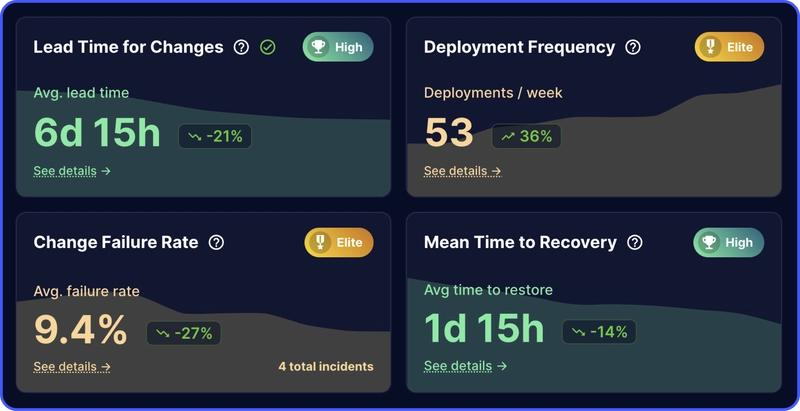

# Git/GitHub Practice

oss GitHub 실습 저장소입니다.

## 학습 목표
- GitHub 저장소 생성 및 관리
- README.md 작성
- Commit을 통한 변경 사항 기록
- Git과 GitHub의 기본 사용법 학습
Git push practice
Git Bash pust test

## DORA Metrics Dashboard

GitHub Actions를 이용해 DORA 4대 지표를 수집합니다.

- Lead Time
- Deployment Frequency
- MTTR
- Change Failure Rate

### 대시보드 시안

## Open Source

본 프로젝트는 오픈소스 협업 학습을 위한 저장소입니다.

### Project Documents

- [License](LICENSE)
- [Contributing Guide](CONTRIBUTING.md)
- [Code of Conduct](CODE_OF_CONDUCT.md)

### Collaboration Rules

- Feature 브랜치 전략 사용
- Conventional Commits 적용
- Pull Request 기반 협업
- [MUST], [SHOULD] 태그를 활용한 리뷰
